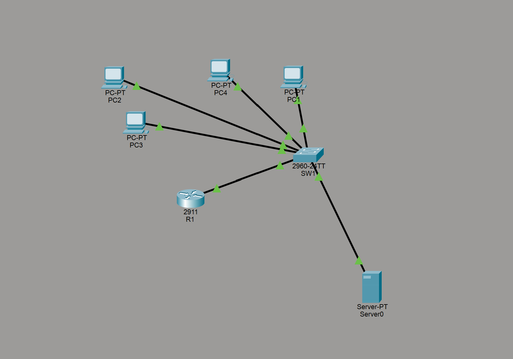

# Small Office Network Simulation (Cisco Packet Tracer)

A small-office network lab built to practice the networking tasks behind IT help desk and desktop support work: VLAN segmentation, router-on-a-stick routing, DHCP, guest isolation with an ACL, SSH administration, switch port security, and structured troubleshooting.

**Author:** Cameron Noce · Computer Science student, Ithaca College  
**Status:** Configuration files and build documentation are prepared; Packet Tracer execution and tests are **not yet verified** in this environment.  
**Scope:** Educational simulation only—not production hardware or a production-ready security design.



## What this project demonstrates

- **VLAN segmentation:** Staff (10), IT and services (20), and Guest (30).
- **Inter-VLAN routing:** Router-on-a-stick through 802.1Q subinterfaces on R1.
- **DHCP:** R1 serves each client VLAN; low addresses are reserved for infrastructure and static hosts.
- **Guest ACL:** Guest devices may use DNS and HTTP on Server0, but may not reach Staff hosts or other devices in IT/services.
- **Basic switch/router hardening:** SSH-only VTY access, local user authentication, endpoint port security, unused access ports shut down, and an MOTD banner.
- **Help desk troubleshooting:** Four reproducible fault-injection exercises with diagnosis, corrective commands, and retest steps.

## Topology and port map

| Device | Packet Tracer model | Interface / port | Connected device | Purpose |
|---|---|---|---|---|
| R1 | Cisco 2911 | GigabitEthernet0/0 | SW1 FastEthernet0/1 | 802.1Q trunk / router-on-a-stick |
| SW1 | Cisco 2960 | FastEthernet0/2 | Server0 | IT/services VLAN 20 |
| SW1 | Cisco 2960 | FastEthernet0/3 | PC1 | Staff VLAN 10 |
| SW1 | Cisco 2960 | FastEthernet0/4 | PC2 | Staff VLAN 10 |
| SW1 | Cisco 2960 | FastEthernet0/5 | PC3 | IT VLAN 20 |
| SW1 | Cisco 2960 | FastEthernet0/6 | PC4 | Guest VLAN 30 |

Use Copper Straight-Through cables. Unused SW1 FastEthernet0/7–24 and GigabitEthernet0/1–2 are put in VLAN 999 and administratively shut down.

## Addressing plan

| VLAN | Name | Subnet | Gateway | DHCP range | Static addresses |
|---:|---|---|---|---|---|
| 10 | Staff | `192.168.10.0/24` | `192.168.10.1` | `192.168.10.50`–`192.168.10.200` | Gateway `.1` |
| 20 | IT / Services | `192.168.20.0/24` | `192.168.20.1` | `192.168.20.50`–`192.168.20.200` | SW1 `.2`; Server0 `.10`; gateway `.1` |
| 30 | Guest | `192.168.30.0/24` | `192.168.30.1` | `192.168.30.50`–`192.168.30.200` | Gateway `.1` |
| 999 | Unused parking | No SVI/subnet | None | None | Unused switch ports only |

All three client pools advertise DNS server `192.168.20.10` and search domain `office.local`. Server0 is statically addressed and must not use DHCP.

## Build it in Packet Tracer

The native Packet Tracer `.pkt` is not generated by the text configuration files. Create the topology once and save it from Packet Tracer to keep an authentic, editable project file.

1. Follow [`docs/packet-tracer-build-guide.md`](docs/packet-tracer-build-guide.md) to place the devices and connect the exact ports.
2. Paste [`configs/R1.txt`](configs/R1.txt) into R1's CLI and [`configs/SW1.txt`](configs/SW1.txt) into SW1's CLI.
3. Configure the static Server0 address, HTTP, and DNS A record using [`configs/server-setup.md`](configs/server-setup.md).
4. Set each PC's IP Configuration to DHCP.
5. Save as `small-office-network.pkt` in this repository root, close it, and reopen it once.

**Lab credential warning:** The IOS files contain a known, lab-only example password so the SSH exercise can be reproduced. It is public and is not suitable for any real device. Change it before adapting the configuration for any other environment.

## Configuration and verification

| Feature | Configured on | Verification command / method |
|---|---|---|
| VLANs and access ports | SW1 | `show vlan brief` |
| Router trunk | SW1 | `show interfaces trunk` |
| Router-on-a-stick subinterfaces | R1 | `show ip interface brief` |
| DHCP pools and bindings | R1 | `show ip dhcp pool`, `show ip dhcp binding`; PC `ipconfig` |
| Guest ACL | R1 | `show access-lists GUEST-IN` |
| Port security | SW1 | `show port-security`; `show port-security interface fa0/3` |
| SSH | R1 and SW1 | `show ip ssh`; from PC3: `ssh -l netadmin 192.168.20.1` or `.2` |
| Disabled unused ports | SW1 | `show interfaces status` |
| HTTP and DNS | Server0 | PC4 browser: `http://www.office.local` |

The expected behavior is documented in [`docs/test-plan.md`](docs/test-plan.md). Results are tracked in [`test-results.csv`](test-results.csv), whose current status is **Not run** for every test. Do not change results to Pass until the tests have actually succeeded in Packet Tracer. See [`docs/troubleshooting-lab.md`](docs/troubleshooting-lab.md) for the four fault tickets.

## Expected policy behavior

- PC1 and PC2 should lease addresses in `192.168.10.0/24`.
- PC3 should lease an address in `192.168.20.0/24`.
- PC4 should lease an address in `192.168.30.0/24`.
- Staff and IT hosts should be able to communicate through R1.
- Guest devices should **not** ping Staff or IT hosts.
- Guest devices should load `http://www.office.local` through the DNS/HTTP exceptions for Server0.
- Guest-to-Server0 ping is expected to be blocked; the policy permits DNS and HTTP, not all traffic to the server.

These are design expectations, not measured results. Packet Tracer versions may differ in supported IOS commands and client features; record any adjustments that are required.

## Repository layout

```text
small-office-network/
├── README.md
├── LICENSE
├── .gitignore
├── configs/
│   ├── R1.txt
│   ├── SW1.txt
│   └── server-setup.md
├── docs/
│   ├── packet-tracer-build-guide.md
│   ├── test-plan.md
│   ├── troubleshooting-lab.md
│   ├── topology.svg
│   └── topology.png
├── screenshots/
│   └── README.md
└── test-results.csv
```

Add `small-office-network.pkt` to the root after saving it from Packet Tracer. Add authentic test screenshots to `screenshots/` once you run the lab. See [`screenshots/README.md`](screenshots/README.md) for suggested filenames.

## Troubleshooting tickets

| Ticket | Fault | Evidence to collect |
|---|---|---|
| TK-001 | PC1 switch port placed in the wrong VLAN | `ipconfig`, `show vlan brief`, successful retest |
| TK-002 | Staff DHCP pool advertises the wrong gateway | `ipconfig`, DHCP pool config, successful retest |
| TK-003 | ACL deny shadows DNS/HTTP permits | browser failure, ACL order/counters, successful retest |
| TK-004 | VLAN 30 omitted from trunk allowed list | `show interfaces trunk`, DHCP failure and recovery |

Use the ticket steps in `docs/troubleshooting-lab.md`. Each fault should be introduced and fixed separately from the known-good baseline, with a before/after screenshot and actual command output.

## Publish to GitHub

Use [`docs/github-publish.md`](docs/github-publish.md) for the commands to create the public portfolio repository and push this folder. The remote GitHub repository is not created as part of this download.

## Limitations and future work

- The project simulates a small LAN; there is no ISP/Internet cloud or NAT in the current topology.
- Packet Tracer is an IOS approximation, so unsupported commands may need version-specific adjustment.
- No real test results or Packet Tracer screenshots are included yet.
- Next steps: optionally add a separate services VLAN, NAT with a simulated ISP, syslog, a guest wireless access point, and more granular guest policy rules.

## About

Built by Cameron Noce, a Computer Science student at Ithaca College graduating December 2026.

- GitHub: [Cnoce0](https://github.com/Cnoce0)
- LinkedIn: [Cameron Noce](https://www.linkedin.com/in/cameron-noce-252197389/)
